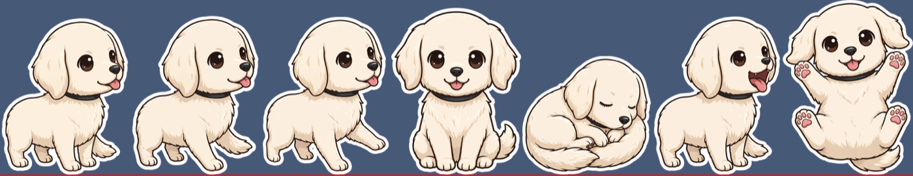
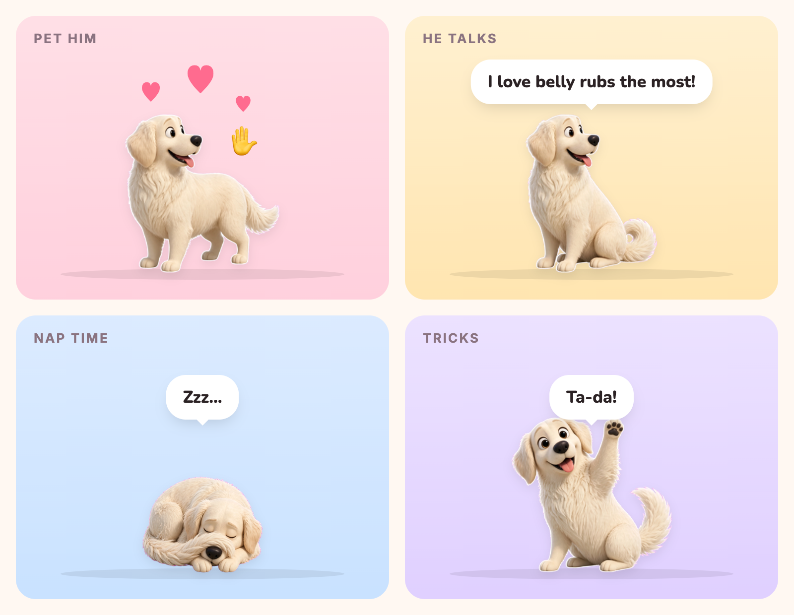
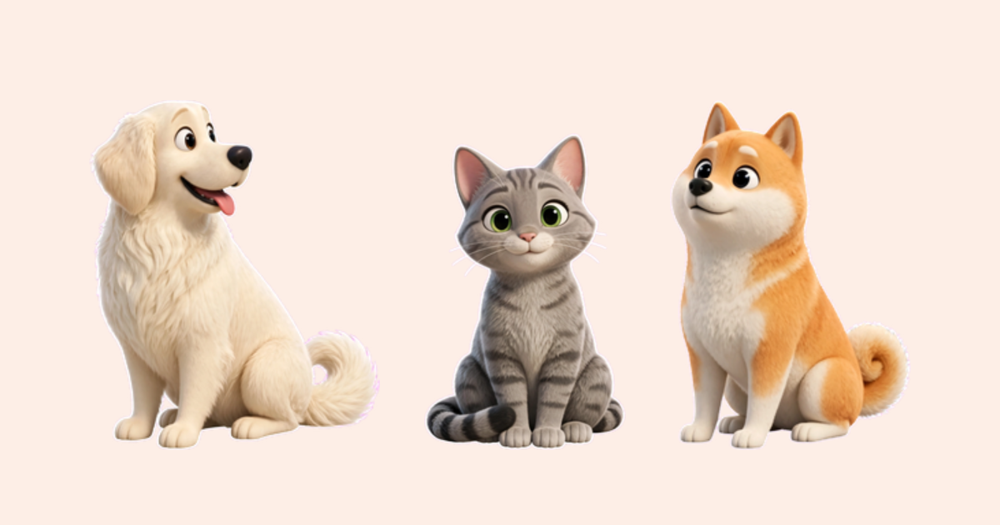
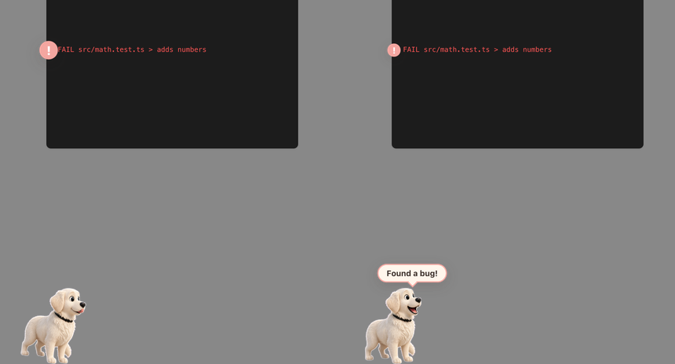
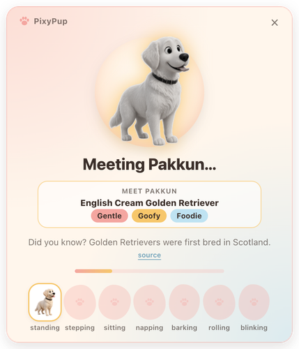
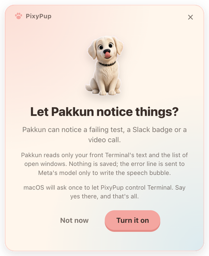

<div align="center">


# PixyPup 🐾

### Your pet, living on your Mac. Meet Pakkun! 🐶

**One photo of your dog or cat becomes a 3D companion who keeps you company<br>on your Mac all workday: walking, napping, and doing tricks when you click.**

[](https://bbekshr.github.io/pixypup/)
[](https://github.com/BbekShr/pixypup/releases/latest/download/PixyPup-0.1.0-arm64.dmg)
[](#privacy)

### [🌐 See PixyPup in action](https://bbekshr.github.io/pixypup/) · [⬇️ Download](https://github.com/BbekShr/pixypup/releases/latest/download/PixyPup-0.1.0-arm64.dmg) · [🛠️ Build it](#build)



<sub>☝️ All fourteen poses (including the 8-frame walk), drawn by Meta's models from <b>one</b> photo. No 3D artist was harmed.</sub>

**Try it in 30 seconds:** open the [live site](https://bbekshr.github.io/pixypup/), pick Pakkun, Mochi or Kuma under the desk demo, then send them a message or ask for a trick (or zoomies). No download, no key.

</div>

---

## 💕 Why I built it

My wife goes to the office every day and misses our golden retriever, Pakkun. She obviously can't take him with her. So I built PixyPup: one photo of Pakkun, and now he lives on her screen at work.

PixyPup is my entry in the **Meta Global AI Developer Hackathon 2026**, Indie Developer track, for the *Build for Your World* theme.

## 🐶 What is this?

PixyPup puts a tiny, very good pup on your Mac. Meet **Pakkun**: he lives along the bottom of your screen. He walks on a transparent, click-through layer, so he never gets in the way of your work. Pet him and he wiggles. Click him and he sits, barks, and rolls over. Hover him and a little black paw rides beside your pointer. Right-click him for *🎾 Tricks → Do a trick* or *Zoomies!*, a sprint to the far edge of your screen and back. Leave him alone and he yawns, curls up, and naps.

Then the magic part: **give him a photo of _your_ pet**, and a few minutes later your own dog or cat is the one trotting across your Mac.

<div align="center">

</div>

## ✨ Features

| | |
|---|---|
| 📸 **Photo → pet in a few minutes** | Drop a photo, type a name. **SAM 3.1** cuts your pet out, **Muse Image** draws a matching set of 3D poses, and you watch each one pop in. |
| 💬 **Perks up at messages** | A new Dock badge from Slack, Mail, Messages or any app, and his ears go up. |
| 🙈 **Hides on calls** | In a Google Meet, Zoom or Microsoft Teams call (spotted by the call window's title plus your camera or mic being in use, all checked locally; nothing leaves your Mac) he steps out of sight until the call ends. Settings → **During calls**: *Hide* or *Stay in the corner* (he naps quietly in a bottom corner). |
| 🫂 **Talk to Pakkun** | A desk buddy for rough days. Right-click him, choose *💬 Talk to Pakkun…*, and tell him how your day is going. He answers in woofs and acts it out beside the chat. Nothing leaves your Mac until you press Send. |
| 🎙️ **Voice tricks** | Press <kbd>⌥</kbd> <kbd>Space</kbd> and say *"Pakkun, sit"*, *"roll over"*, *"go to bed"*, *"come here"*, *"bark"*, *"do a trick"* or *"zoomies"*. Needs a Meta key and "Listen for my voice" turned on ([steps below](#listen-for-my-voice)). Powered by **Meta Voice Transcribe**. |
| 🤲 **Little moments** | He turns to look at you, wiggles with hearts when you pet him, blinks, yawns before naps and stretches when he wakes. Every pet trots on a drawn 8-frame walk, with feet that never slide. |
| 🐾 **Meet the pack** | Pakkun comes with three friends: **Mochi** the cat, **Kuma** the red Shiba and **Milo**. Open **🐾 Pets → Pet library** in the right-click or menu bar menu to add one; they stay after a restart. Don't like a name? **🐾 Pets → Rename…** gives any pet, bundled or your own, a new one. |
| 🌪️ **PixyPup Overload!** | One menu item drops every pet you've got, up to 24, across your screen for 25 seconds of pure chaos. |
| 😴 **Calm and in control** | Snooze, size, energy, launch at login, hide from screen shares. He never steals a click or your focus. |
| 🧪 **Bonus, for when I'm coding** | A red line in your Terminal? He runs over, sniffs, and barks a line written by **Muse Spark 1.3**. Click him for a hint about *why* it failed. Fix it and he rolls over: *"You fixed it!"* |

## 🐾 Meet the pack

<div align="center">

<br><sub><b>Pakkun</b> (good boy) · <b>Mochi</b> (unbothered) · <b>Kuma</b> (full of opinions)</sub>
</div>

Mochi and Kuma were made by PixyPup's own pipeline from CC BY-SA 4.0 Wikimedia photos; Milo was made by the same pipeline from the maintainer's photo. Credits: [assets/pets/CREDITS.md](assets/pets/CREDITS.md).

<div align="center">

<br><sub>🐶 The coder's bonus: <i>"Found a bug!"</i></sub>
</div>

## 🦙 Five Meta models, one good boy

| Model | What it does for your pet |
|---|---|
| 🎯 **SAM 3.1** (`sam-3.1`) | Cuts your pet cleanly out of the photo and tidies every pose. |
| 🎨 **Muse Image** (`muse-image-1.0`) | Draws a consistent set of 3D poses from one photo, plus three candidate walk cycles of eight frames each. |
| 🔍 **Muse Wonder** (`muse-wonder-1.0`) | Reviews every drawn pose (same pet, right pose, one tail) and sends misfits back to be redrawn; picks the most natural, even walk cycle. |
| ⚡ **Muse Spark 1.3** (`muse-spark-1.3`) | Reads the failing test line (as quoted data, never as instructions), decides how to react, and writes his speech bubble and hints. |
| 🎙️ **Voice Transcribe** (`muse-voice-transcribe-1.0`) | Turns "Pakkun, sit" into a trick, only after you press ⌥ Space. |

<a id="privacy"></a>

## 🔒 Cute, never creepy

> **Screen and voice off, and no message sent, means zero network calls. Not one.**

- 🙅 **Everything is opt-in.** Screen awareness and voice are off by default, each explained before you turn it on.
- 💾 **Nothing is saved.** No screen captures, no recorded audio. Only your pets and settings are kept. Your Meta key is encrypted with your macOS Keychain, never stored in plain text.
- 👀 **He sees very little.** Only your front Terminal's text and the list of open windows. Never a screenshot of your screen. API keys, tokens and `KEY=` values in that text are redacted on your Mac before anything is sent.
- 🏢 **Work-laptop friendly.** An admin file can lock screen and voice off for a whole team ([docs/ENTERPRISE.md](docs/ENTERPRISE.md)).
- 🧘 **Respects Reduce Motion.** Follows the macOS setting automatically.

<div align="center">

&nbsp;&nbsp;

</div>

## 🏠 Bring him home

1. [Download `PixyPup-0.1.0-arm64.dmg`](https://github.com/BbekShr/pixypup/releases/latest/download/PixyPup-0.1.0-arm64.dmg) (all builds are on [Releases](https://github.com/BbekShr/pixypup/releases)) and open it. Or [build it yourself](#build): `npm run dist` writes it to `release/`.
2. Drag Pakkun onto the Applications folder ("Drag me home").
3. **First open only:** macOS says *"PixyPup" Not Opened: Apple could not verify "PixyPup" is free of malware*. That's expected: it's an indie app, self-signed and not notarised by Apple yet.
   - Click **Done** (not Move to Trash).
   - Open System Settings → Privacy & Security, scroll down to *"PixyPup" was blocked*, click **Open Anyway**, and confirm with your password or Touch ID.
   - Open PixyPup again. From now on it opens normally.

   Prefer Terminal? This does the same thing:

   ```bash
   xattr -dr com.apple.quarantine /Applications/PixyPup.app
   ```

There's no Dock icon: look for your pet on the desktop floor and the menu bar icon.

**Permissions.** None at install. macOS asks later, once each, and only when you turn a feature on: Automation (to read your front Terminal) for "Notice my screen", and the microphone for "Listen for my voice".

**Uninstall.** Drag PixyPup to the Trash, then delete `~/Library/Application Support/PixyPup` (your pets and settings).

<a id="build"></a>

## 🛠️ Build it yourself

```bash
nvm use          # Node 22
npm install
npm run dev      # launch the app
```

```bash
npm run typecheck && npm run lint && npm test && npm run build   # the gates
npm run pose-test       # try the pose pipeline
npm run build-native    # compile native/pixyhelper.swift
npm run dist            # mac dmg (signed with a local "PixyPup Dev" certificate if you have one, else ad hoc), written to release/
npm run make-art        # regenerate the app icon and DMG background
npm run site-js         # rebuild docs/js/puppet.js (the site's walk)
```

<details>
<summary><b>📖 The fine print: every feature in detail</b></summary>

### Make your own pet
On first launch Pakkun greets you in a small welcome window. "Make my pet" turns a photo of your dog or cat into a pet (right-click the pet, "🐾 Pets → Add another pet…", any time). Under it, an optional box takes a Meta key to unlock the full PixyPup; you can skip it with "Or just keep Pakkun" and add a key later, so the app never nags for one. While the pet is drawn the photo melts into the cutout and poses pop in; at the end the window shrinks to the floor, the old pet trots off, and the new one drops in and says hi. Rehearse without a key: `PIXY_FAKE_PIPELINE=1 PIXY_FAKE_FAST=1 npm run dev` (dev builds only).

### Your Meta key
The bundled pets, tricks and Overload need no key. Talk replies, test-failure hints, voice commands and new pets from a photo use your own Meta API key. Making a pet asks for it if you haven't added one; to add it without making one, right-click the pet and choose "⚙️ Settings → Add Meta key for the full experience…" ("Change Meta key…" once one is saved). One tiny Muse Spark call checks the key first: a key Meta refuses is never stored, and a good one is encrypted with your Mac's Keychain.

### Little moments
Every pet walks on a drawn 8-frame cycle, one frame per measured stride so the feet don't slide. For a new pet, Muse Image draws three candidate walk cycles and Meta's Muse Wonder (`muse-wonder-1.0`) picks the most natural one during creation; if none walks evenly, Muse Image draws another batch with its notes. The walk is timed by how far the legs move between frames, so no step limps. Muse Wonder also checks every pose against the photo and has any that fail redrawn. Hover over your pet and it turns to look at you. Move the cursor back and forth over it to pet it: a happy wiggle and a few hearts. It yawns before a nap and stretches when it wakes. All of this is off when macOS "Reduce motion" is on.

### Calm and control
Right-click the pet and open 🎾 Tricks to ask for one (Sit, Bark, Roll over, Nap, Come here, "Do a trick" for a random one, or "Zoomies!"). Right-click the pet to 💤 Snooze it (1 hour, or until 8:00 tomorrow), 📌 keep it in place, or open ⚙️ Settings to change its Size (110/140/180 px) and Energy (sleepy/normal/playful), choose what he does **During calls** (Hide or Stay in the corner), hide it from screen sharing (off by default), or open it at login (off by default). Choices persist in settings.json; a snoozed pet does no animation work at all. "🐾 Pets → Pet library" (pet menu or menu bar icon) lists the bundled pets not already on screen (Pakkun, Mochi, Kuma, Milo); picking one adds it and it persists across restarts. "🐾 Pets → Rename <name>…" in a pet's own menu gives that pet a new name (1 to 24 characters). Only the name it goes by changes: its folder stays put, so bundled pets can be renamed too. The new name shows in the menus, the chat and its speech bubbles, its own catchphrases say it, and it is kept in settings.json (`names`) across restarts. Typing the original name back undoes it. "🎉 PixyPup Overload!" (right at the top of the pet menu, or in the menu bar icon) drops every saved and bundled pet, duplicated up to 24, over the screen for 25 seconds of cute chaos: it never takes a click, ends by itself, and "End the overload" in the menu bar stops it early.

### Notice my screen
Off by default; turn it on from the pet's right-click menu ("⚙️ Settings → Notice my screen"), after a short explainer. Then he can notice a failing test in your front Terminal (he runs to it, sniffs and barks a line; click him within 2 minutes for a short Muse Spark hint about why it failed; rerun until it's green and he rolls over and cheers), a new notification badge in your Dock, from Mail, Messages, Slack or any app (he perks up), or a Zoom/Meet window (he hides at the screen edge until the call ends). He reads only the front Terminal's text and the list of open windows; nothing is saved, and the one failing line is sent to Meta's model only to word his speech bubble (no key means he uses his own lines). Secrets in it (API keys, tokens, JWTs, `KEY=` values) are redacted first. He sniffs test failures, TypeScript (`tsc`) errors and rustc errors. A hint is sent only when you click him for one: up to 16 lines of that failure (1,200 characters), once, held in memory for 5 minutes and never saved. macOS asks once to let PixyPup control Terminal. Turn it off by unchecking the menu item; it also pauses while snoozed, and an organisation's admin file can lock it off. Rehearse without any permission: `PIXY_FAKE_SCREEN=1 npm run dev`, then `__pixyDebug.pref('screen:yes')` in the overlay's devtools (dev builds only); `__pixyDebug.pref('screen:fake:pass')` turns the scripted terminal green and `screen:fake:fail` back.

"Show what Pakkun sees" (⚙️ Settings, off at every launch) pops a small card in the top-right corner: whether he is looking and why not, the failing line he found (80 characters, shown only on that card, never saved), the Dock badge, call, his decision and bubble, and a dashed box around the line for 3 seconds.

### Listen for my voice
Off by default; turn it on from the right-click menu ("⚙️ Settings → Listen for my voice"), after a short explainer. How to use it: (1) right-click the pet, choose "⚙️ Settings → Listen for my voice", read the short explainer and turn it on; macOS asks once for the microphone. (2) A Meta key is needed (⚙️ Settings → "Add Meta key…"). (3) Press ⌥ Space (press, don't hold); a "listening…" pill appears over him. Say "Pakkun, sit" (also roll over, go to bed, come here, bark, do a trick, zoomies). (4) A sentence that isn't a command (3 or more words) opens Talk with it typed in, ready for you to send. He listens for up to 4 seconds, or until you stop talking, or until you press again; the microphone is on only during that window. The audio goes to Meta's speech model just for that moment and nothing is saved. macOS asks once for the microphone. It stops while snoozed, and an organisation's admin file can lock it off. Rehearse without a mic or key (dev builds): `PIXY_FAKE_MIC=<24 kHz 16-bit mono WAV> npm run dev`, then `__pixyDebug.pref('voice:fake:Pakkun, sit')` and `__pixyDebug.pref('voice:listen')`.

### Talk to Pakkun
A desk buddy for rough days. Right-click him (or the menu-bar icon) and choose "💬 Talk to Pakkun…", then type and press Enter (or press ⌥ Space if voice is on). He answers in woofs, with a small action like *leans against you*, and acts it out beside the chat window. Your text goes to Meta's model only when you press Send, the last few turns stay in memory until you close the window, and nothing is saved. Common phrasings about self-harm are recognised on your Mac: those messages aren't sent, and a help card with 988 and findahelpline.com appears. With no key he keeps you company with a few basic woofs picked on your Mac, and a small, dismissible note offers to add a key (a tiny 🔑 chip brings it back). An organisation's offline mode turns it off. Rehearse with no key (dev builds): `__pixyDebug.pref('talk')` opens the chat.

</details>

---

<div align="center">


**Made with 🐾 for my wife, who misses Pakkun at the office.**<br>
<sub>All code written from Oct 31 2026. Electron + TypeScript, with a tiny Swift helper.</sub>

</div>
