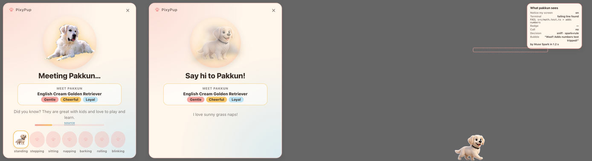

# End-to-end test, 2026-11-01

One fresh launch of the dev app (`npm run dev`, isolated user data) with the real Meta key, driven over the Chrome DevTools Protocol by `out/_e2e.mjs`. Screen and microphone inputs are scripted (`PIXY_FAKE_SCREEN=1`, `PIXY_FAKE_MIC=<recorded "Pakkun, can you roll over?">`, `PIXY_DEV_PHOTO=<a real photo of Pakkun>`); every Meta model call is real.

| # | Check | Result |
|---|---|---|
| 1 | First launch shows the built-in 3D Pakkun | pass |
| 2 | First launch opens the welcome window | pass |
| 3 | Zero outbound connections before the user creates a pet (15 s, `lsof`) | pass |
| 4 | Real pet created from the photo (SAM 3.1 + Muse Image) | pass, 39 s |
| 5 | Muse Spark personality on the birth screen | pass |
| 6 | Search-grounded breed fact during the wait | pass |
| 7 | New pet drops in and wanders | pass |
| 8 | Size Small / Medium / Large apply live | pass (110 / 140 / 180 px) |
| 9 | Snooze rests the pet | pass |
| 10 | Wake brings it back | pass |
| 11 | Screen-aware sniff fires on the failing line | pass |
| 12 | Sniff bubble written by Muse Spark | pass: "Woof! Adds numbers test tripped!" (1.2 s) |
| 13 | Voice command heard and performed | pass: heard "Pakkun, can you roll over?", pet rolled |

The packaged app (`npm run dist`, ad-hoc signed DMG) was verified separately from a scratch copy: overlay with the walking 3D Pakkun, welcome window on first launch, no dev hooks, helper runs from Resources (F10).

## Needs the maintainer once (macOS permission prompts)
- Real Terminal sniff: the first "Notice my screen" tick asks to let PixyPup control Terminal.
- Dock badge perk-up: Accessibility for PixyPup (or the host terminal in dev).
- Real microphone: the first ⌥ Space asks for the microphone.
See docs/DEMO.md for the rehearsal steps.
