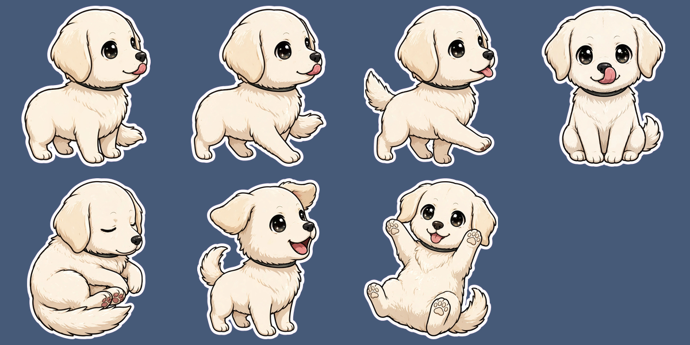

# Pose test, 2026-10-31

Run: `npm run pose-test` on `assets/photos/IMG_4591.HEIC` (Pakkun, cream golden retriever, sitting).
Models: `sam-3.1` for the cutout, `muse-image-1.0` via `/v1/images/edits` for poses.
Cost: 1 SAM image + 7 generated images, about $0.07. Results stay in gitignored `out/pose-test/`.

## Decision: keep all 6 behaviours

idle, walk (2 frames), sit, sleep, bark, roll. Every pose reads as the same dog: coat colour, ear
shape, eyes, collar, tongue and sticker outline all hold. The idle-as-second-reference trick works.

| Stage | Time | Magenta bleed after local chroma key |
|---|---|---|
| SAM cutout | 3.0 s | n/a (clean edges, no background left) |
| idle_0 (photo only as reference) | 10.3 s | 0.07% |
| walk_0, walk_1 | 22.1 s, 20.4 s | 0.08%, 0.08% |
| sit, sleep, bark, roll | 12.2, 11.9, 19.1, 15.3 s | 0.07-0.09% |
| **Total, sequential** | **~114 s** | |

Chroma key alone is clean enough: the SAM re-cut fallback is not needed for poses.

## Findings that change the build

1. **Too slow sequentially.** 114 s misses the 60-90 s target. Generate idle first, then the other
   six in parallel (rate limit is 150 images/min): expected ~35 s. (F3)
2. **Poses come out at different scales** because each is trimmed on its own. The overlay must
   normalise every pose to one body height (e.g. idle's) and anchor at `footY`. (F3/F4)
3. **Muse Image returns WebP**, not PNG. The pose test saves it as `*_raw.png`; the pipeline should
   read the real type. Harmless today because the keyed outputs are re-encoded PNGs.
4. **Sleep is a sitting doze**, not curled up. Acceptable; tighten the prompt only if time allows.
5. **iPhone HEIC needs `sips`**: sharp's prebuilt libvips has no HEVC decoder (fixed in the script).

## SAM 3.1 cannot find terminal text

Synthetic terminal screenshot of a failing vitest run (two red failure lines, one red summary).
SAM 3.1 returned **0 matches** for "red text", "red error message", "error text" and even "text"
(0.7-1.9 s per call). SAM segments objects, not glyphs.

**Replacement (prototyped, works):** scan the terminal crop locally for red-dominant pixels
(`r > 180`, `r - g > 80`, `r - b > 80`) and group rows into lines. It found exactly the three red
lines with tight boxes, in milliseconds, with no network call. The sniff targets the last red line.
SAM 3.1 stays where it is strong: cutting the pet out of the photo.

## 3D style

Decision (maintainer): "it has to be 3d". `STYLE` in `src/api/pose-pipeline.ts` now asks for a
Pixar-style 3D animated-movie character instead of the flat chibi sticker, and the walk is a
4-frame cycle (walk_0..walk_3, 8 fps) with walk_0 as a third reference for walk_1..3.
Live result from a side session (pack at `out/pack3d/Pakkun`): 7 poses consistent, 54.2 s total,
cream coat and collar kept. Soft fur edges stress the chroma key, so the despill path stays and is
covered by a test with a semi-transparent fur fringe.
